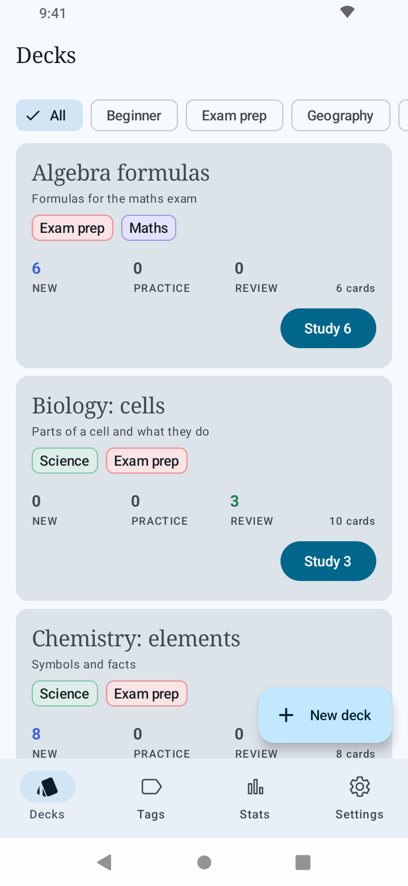
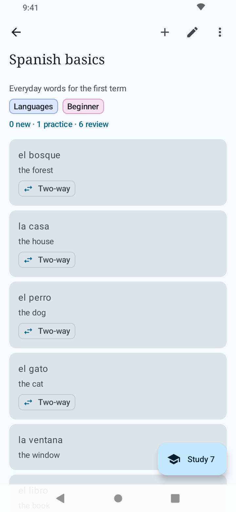
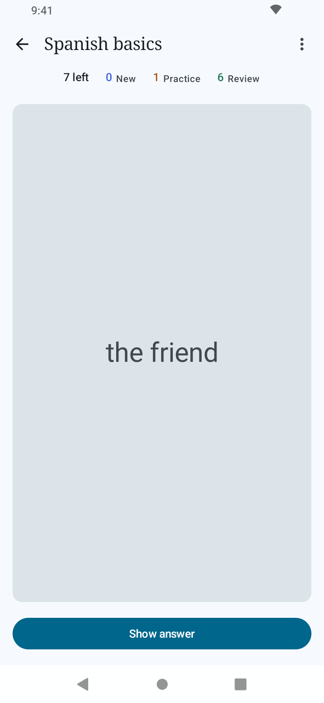
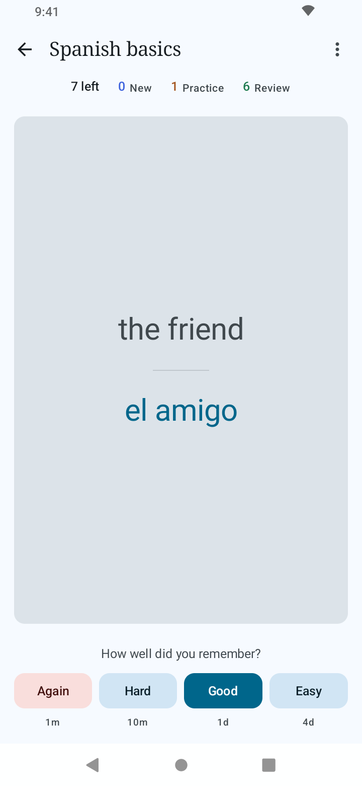
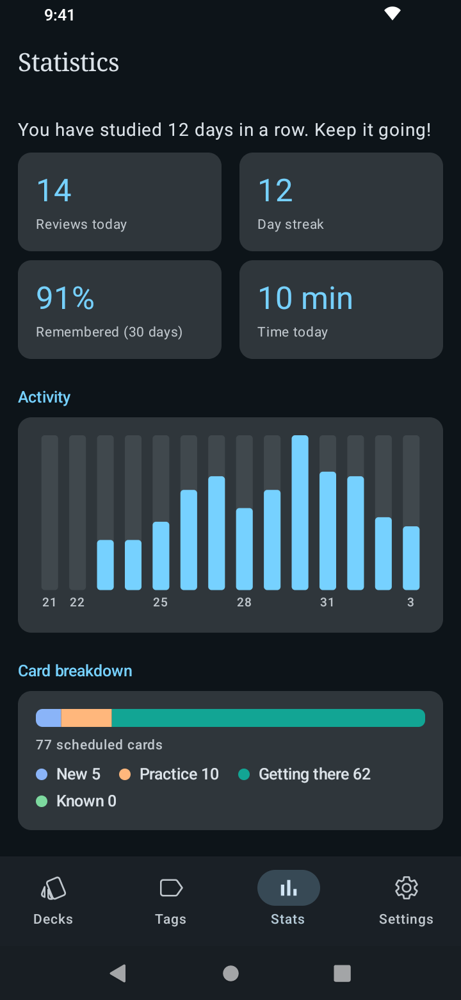
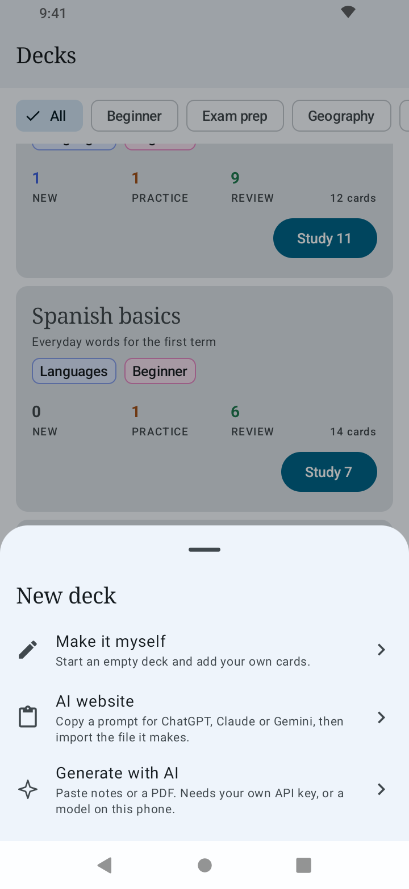

<div align="center">


# Flashback

**Study smarter. Offline, private and free.**

Flashback is a simple, open-source flashcard app for Android. Your decks live on your phone, cards are scheduled with spaced repetition so you review them right before you would forget them, and there is no account, no ads and no tracking.


</div>

## Features

* **Spaced repetition that works:** Cards are scheduled with an SM-2 scheduler in the four-button style (Again, Hard, Good, Easy), with learning and relearning steps. The buttons show when you will see the card next.
* **Three ways to answer:** Flip the card and rate yourself, type the answer, or pick from choices. Typed answers ignore case, accents and small typos, and the app suggests a rating that you can always change. Set a default in Settings and override it per card.
* **Decks, cards and tags:** Group decks with tags and filter the deck list by tag. Make a card two-way to also be asked back to front, with each direction scheduled on its own. Hide a card for now without deleting it.
* **Progress you can see:** Cards left in the session, a day streak, how much you remembered over the last 30 days, a daily activity chart and a breakdown of new, practice, getting-there and known cards.
* **Undo:** Undo your last answer, and undo deleting a deck, card or tag.
* **Daily reminder:** An optional once-a-day nudge when you have cards to review.
* **Make cards faster (optional):** Paste notes or a PDF and let AI draft the cards, then review them before saving. Use your own Anthropic or Google Gemini key, a Gemma model that runs on your phone so nothing is sent anywhere, or copy a ready-made prompt into any AI website and import its reply. See [Privacy](#privacy).
* **Backup:** Export your decks to a JSON file and import them back, from a file or by pasting text.
* **Themes:** Light, dark, dynamic colour, and medium or high contrast.
* **Accessible:** Results are announced to screen readers, not only shown with colour, and the study screen adapts to landscape and to the keyboard.

## Screenshots

<div align="center">
  
  
  
  
  
  
</div>

## Getting Started

You need Android 10 (API 29) or later. Download the APK from the [releases](https://github.com/mowtiie/Flashback/releases) page, install it, and create your first deck. There is nothing to sign up for and nothing to set up.

To make cards with AI, open **Settings → AI card generator** and either add your own API key for Anthropic or Google Gemini, or choose a Gemma model file (ending in `.litertlm`) to make cards on the phone. You can also skip all of that: **New deck → AI website** gives you a prompt to paste into ChatGPT, Claude or Gemini together with your notes, and then imports the file it makes.

## Privacy

Your decks, study history and settings stay on your device. The developer runs no server and cannot see them. The only network feature is the optional AI card generator, which sends the text or PDF you choose, with your own API key, to the provider you selected. Nothing is sent unless you use it. Read the full [privacy policy](PRIVACY.md), which is also in the app under **Settings → About**.

## Verification

APK releases on GitHub are signed using my key. They can
be verified using
[apksigner](https://developer.android.com/studio/command-line/apksigner.html#options-verify):

```
apksigner verify --print-certs --verbose flashback-vX.X.apk
```

The certificate fingerprints of the signing key will be listed here with the first signed release. Only install Flashback APKs whose fingerprints match, since verifying the signature confirms you are running a genuine, unmodified build.

### PGP Signing

As an additional layer on top of the Android signature, each release is also signed with my PGP key. While `apksigner` confirms the APK itself is intact, a PGP signature confirms that *I* am the one who published this specific file to GitHub, an independent check that doesn't rely on GitHub's account security alone.

**Public key fingerprint:**
```
9EA2 8F46 7802 5092 7643 1B69 42B5 FA42 AA63 90E1
```

Download and import the key from my website:

```
curl -O https://mowtiie.cc/PGP_PUBLIC_KEY.asc
gpg --import PGP_PUBLIC_KEY.asc
```

After importing, confirm the fingerprint printed by GPG matches the one listed above. That match is what actually establishes trust, not the import step itself.

Each release includes a detached `.asc` signature alongside the APK. Verify a downloaded release with:

```
gpg --verify flashback-vX.X.apk.asc flashback-vX.X.apk
```

A valid signature looks like:

```
Good signature from "Mowtiie <mowtiie.dev@gmail.com>"
```

**Note:** PGP signing is a supplementary trust measure, not a substitute for the `apksigner` check above. Verify both if you want the highest confidence that a release is genuine and unmodified.

## Mapping Files

Each release on GitHub includes a `mapping-<version>.txt` file alongside the APK. This file is needed to deobfuscate stack traces from crash reports: match the file to the version shown in the crash report header and use it with `retrace` from the Android SDK.

## Support

If you enjoy using Flashback, you can support its development on [Ko-fi](https://ko-fi.com/mowtiie).

## License

This project is licensed under the GNU General Public License v3.0. See the
[LICENSE](LICENSE) file for details.
